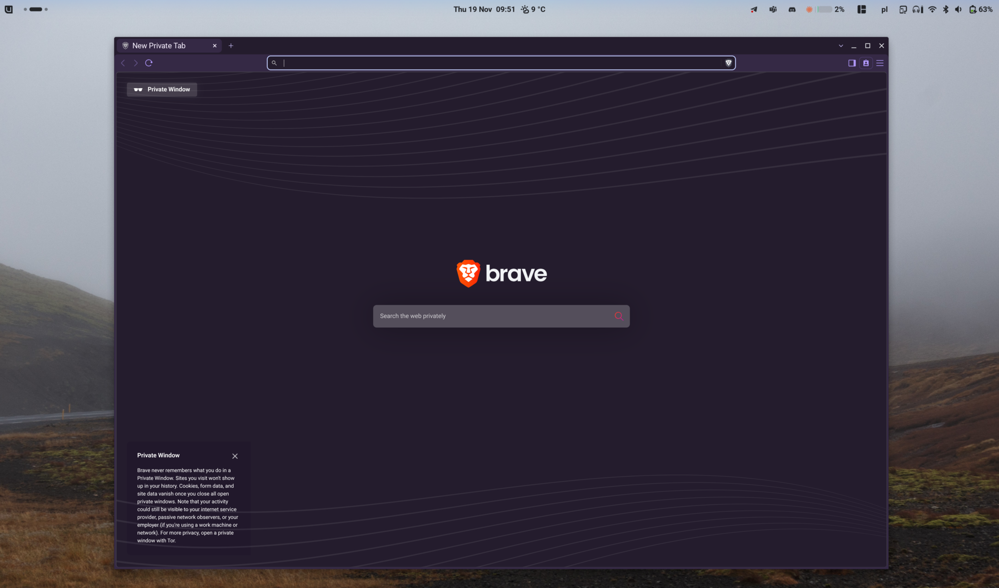
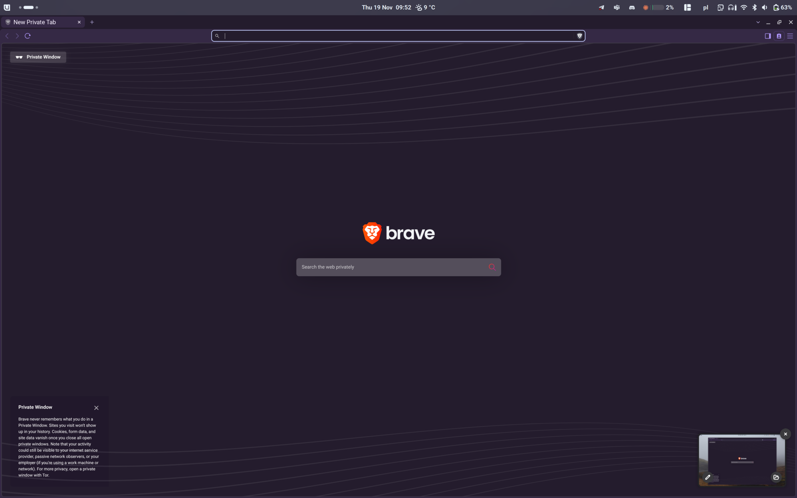
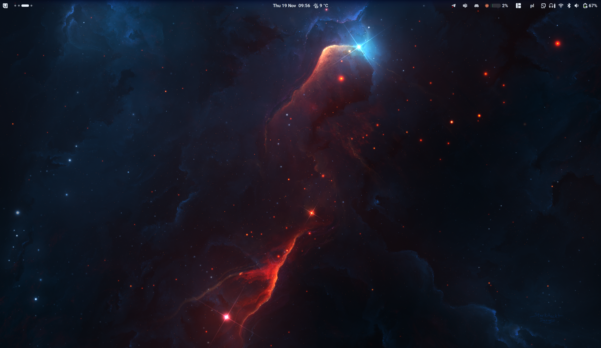
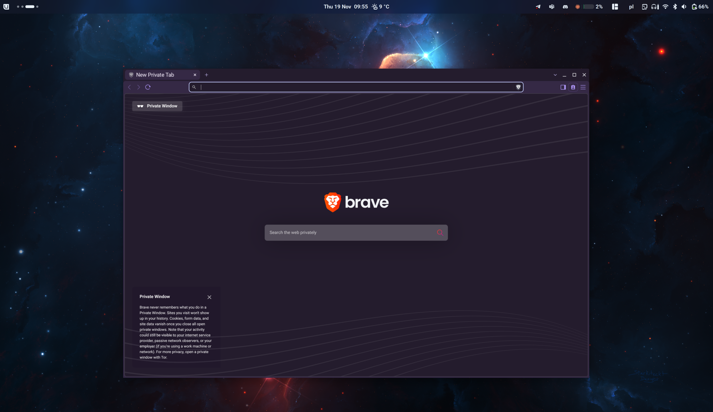

# Panel Color Matcher GNOME Shell Extension

[](https://extensions.gnome.org/extension/9260/panel-color-matcher/)

Panel Color Matcher is a GNOME Shell extension to dynamically change the
top panel color to match the wallpaper or a maximized window, with a
range of customization options (opacity, gradient, saturation, text
contrast and shadow, and accent color syncing) to match anyone's
preference. Color changes crossfade smoothly instead of snapping.

## Installing

Panel Color Matcher is available at ego:
https://extensions.gnome.org/extension/9260/panel-color-matcher/

### Developers

To install from the source repository during development, run

```bash
make install
```

Activate in the GNOME Extensions app.

## Compatibility

Panel Color Matcher works together with [Blur my Shell](https://extensions.gnome.org/extension/3193/blur-my-shell/):
if its panel blur is enabled, the gradient mask is applied to the blur
itself so the two blend dynamically instead of fighting each other.

## Known Limitations

- Blur my Shell's **static** panel blur is not yet supported; only its
  dynamic blur blends properly with the panel's gradient.

## Screenshots

Color from a regular window:


Color from a maximized window, with opacity:


Color from a dark wallpaper, with gradient:


Color from a dark wallpaper, with gradient turned off:

